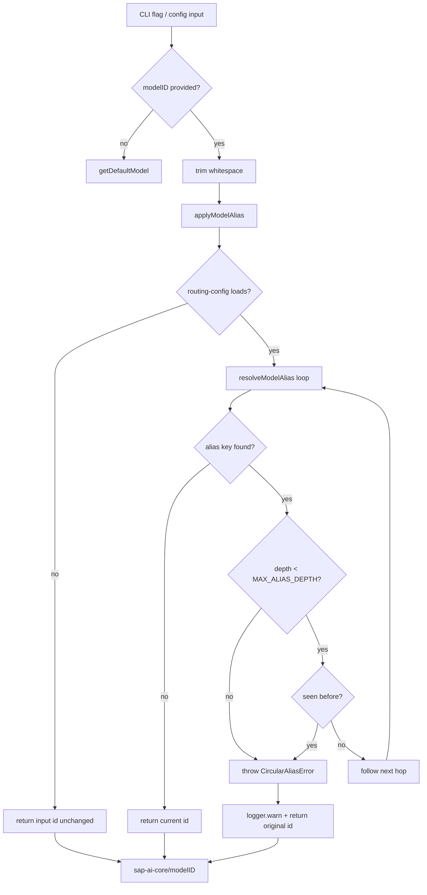

# Routing

> This file is auto-generated by the documentation workflow. Manual edits will be overwritten.

<!-- Content will be generated by the documentation workflow -->

## Custom model metadata preservation across model-id changes

Alexi's routing configuration (`routing-config.json`) lets a user attach
custom metadata to a model entry:

- `costTier` (`cheap` | `medium` | `expensive`)
- `strengths` (task-type tags used for scoring)
- `maxTokens` (custom context window)
- `reasoning` (routing hint)
- `inputPrice` / `outputPrice` (per-1M-token pricing overrides)
- `supportsPromptCache` (prompt-cache capability flag)

When an interactive editor changes the `id` field of an existing model
entry, that metadata MUST be recommitted under the new id. If it is not,
the new id resolves through the model catalog to safe defaults
(`inputPrice`/`outputPrice` = 0, `supportsPromptCache` = false) and paid
requests can be silently billed as free. This mirrors the fix in Cline
PR #12628.

The mechanism lives in `src/config/pendingOverrides.ts`:

- `PendingOverridesStore.stage(modelId, overrides)` records overrides to
  be applied at the next persist.
- `PendingOverridesStore.renameModelId(oldId, newId)` carries staged
  overrides from `oldId` to `newId` and marks the rename as in-flight so
  concurrent edits during the commit round-trip target the new id, not
  the stale old id being read back from disk.
- `PendingOverridesStore.stageWhileCommitting(modelId, overrides)` is
  the race-safe entry point for editors: if a rename is in flight it
  automatically routes the edit to the pending id.
- `applyPendingOverrides(models, pending)` merges the staged map into a
  `ModelCapability[]` (patching existing entries, appending complete new
  ones, reporting incomplete/unresolved ids).
- `saveRoutingConfig(config, path?)` persists the merged config.

Modes are supported via an optional `mode` argument so future plan/act
splits can scope overrides independently without a schema change.

## Model aliases

Users repeatedly type long SAP AI Core model ids like
`sap-ai-core/anthropic--claude-4.7-opus` on the CLI and in config files.
The optional `modelAliases` section of `routing-config.json` maps short
names to canonical model ids:

```json
{
  "modelAliases": {
    "opus":   "sap-ai-core/anthropic--claude-4.7-opus",
    "sonnet": "sap-ai-core/anthropic--claude-4.5-sonnet",
    "haiku":  "sap-ai-core/anthropic--claude-4.5-haiku"
  }
}
```

With that block in place, every invocation accepts the short name:

```bash
alexi chat -m opus "Explain this diff"
alexi agent -m sonnet "Refactor src/core/router.ts"
```

The CLI's `-m` flag, `AICORE_MODEL`, and in-process callers that pass a
`modelID` to `getModel()` all go through the same resolver, so the alias
is interchangeable with the canonical id.

### Resolution rules (`src/config/modelAliases.ts`)

- `resolveModelAlias(nameOrAlias, aliases)` returns the canonical id when
  `nameOrAlias` is a known alias key, otherwise returns the input
  unchanged (so canonical ids pass straight through).
- Aliases may chain (`a -> b -> c -> real-id`) up to `MAX_ALIAS_DEPTH`
  levels (`5`). The depth cap exists so a pathological chain can never
  hang the chat pipeline.
- Direct and indirect cycles (`a -> b -> a`, `a -> a`) throw
  `CircularAliasError` with the full chain preserved on the error's
  `chain: string[]` field (e.g. `['a', 'b', 'c', 'a']`). The chat
  pipeline logs a warning and falls back to the input id so a
  misconfigured alias does not break requests.
- Reaching `MAX_ALIAS_DEPTH` without converging on a non-alias is also
  reported as `CircularAliasError` (chain ends in `'...'`).
- Alias keys are trimmed before lookup, so leading / trailing whitespace
  in CLI input (`"  opus  "`) still resolves. Empty / whitespace-only
  alias values are ignored (treated as "no alias" — the input is
  returned verbatim).
- Resolution is **case-sensitive**: `opus` and `Opus` are distinct keys.
- Alias keys that collide with real SAP orchestration model ids log a
  warning (`shadows a real SAP orchestration model id`) at validation
  time but still work; the alias wins when resolved.

### Validation (`validateModelAliases`)

`validateModelAliases(aliases)` is a pure function (only side effect is
`logger.warn`) that walks the alias map once and returns the list of
alias keys that failed validation. It flags:

- Empty keys (reported as `Model alias: ignoring empty alias key`).
- Empty / non-string values (reported as `Model alias '<key>': value is
  empty, ignoring`).
- Keys that shadow a real SAP orchestration model id (warning only; the
  entry stays active).
- Cycles (both participants of a `a -> b -> a` cycle are returned).

Validation is designed to fail soft: a bad entry is reported and
skipped, the rest of the alias map continues to work, and the chat
pipeline keeps running.

### Call-site wiring (`src/providers/model-selection.ts`)

`applyModelAlias(modelId)` is the public wrapper. It loads the alias map
through `loadRoutingConfig().modelAliases`, swallows any routing-config
load error (missing or malformed `routing-config.json` simply means
"no aliases configured"), and delegates to `resolveModelAlias`. On
`CircularAliasError` it logs a warning and returns the original id
verbatim so an auxiliary call site never fails because of a
misconfigured alias chain.

`getModel(modelID?, opts?)` in the same module runs
`applyModelAlias(trimmed)` **before** provider lookup when the caller
supplies an explicit `modelID`. The CLI entry points (`chat`, `agent`,
`interactive`) and `getProviderForModelWithFallback` therefore pick up
short names without a per-command code change.

### Alias resolution flow


